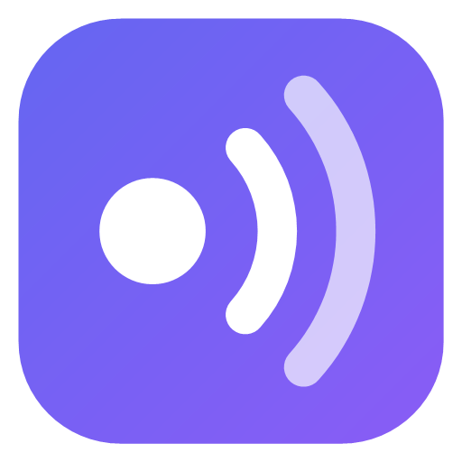
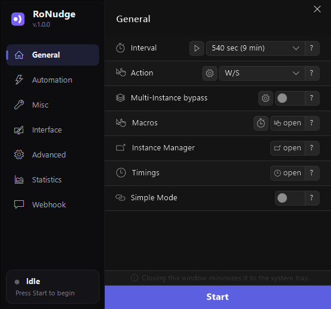
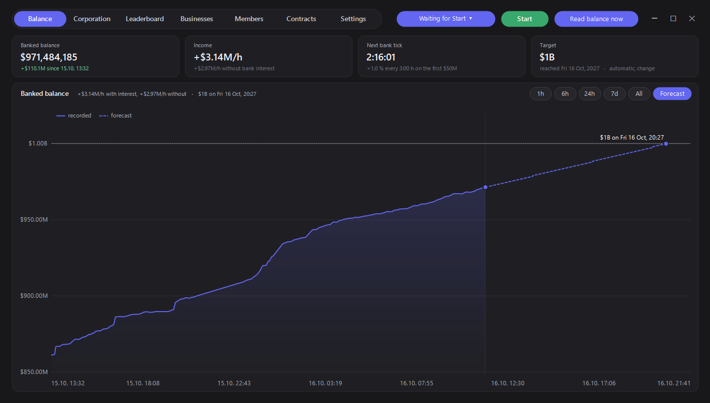
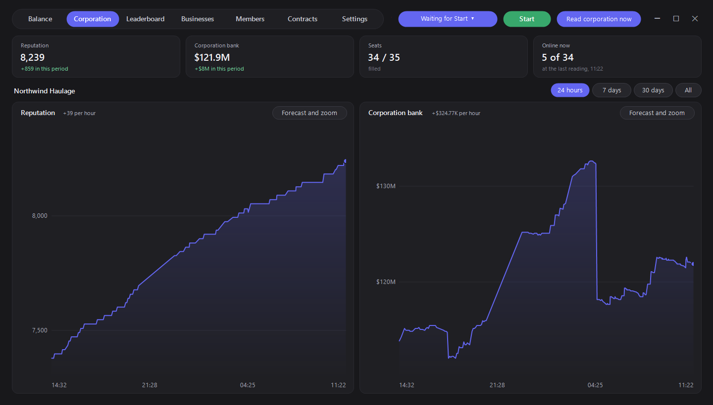
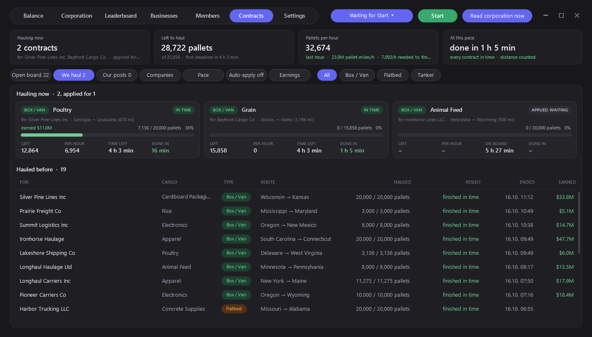
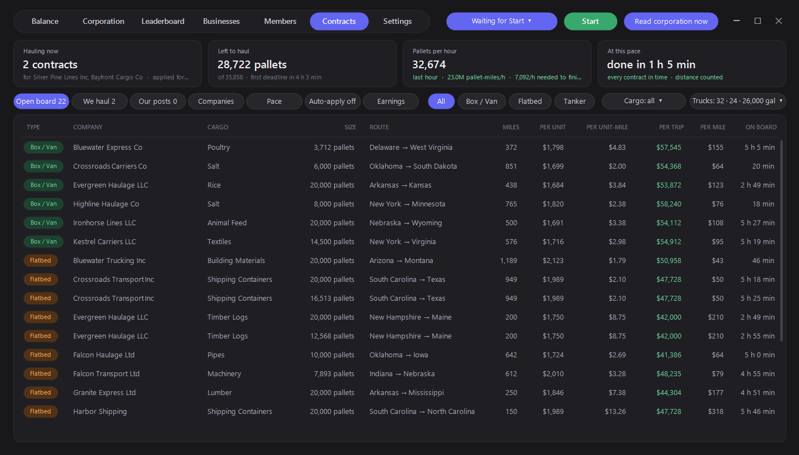
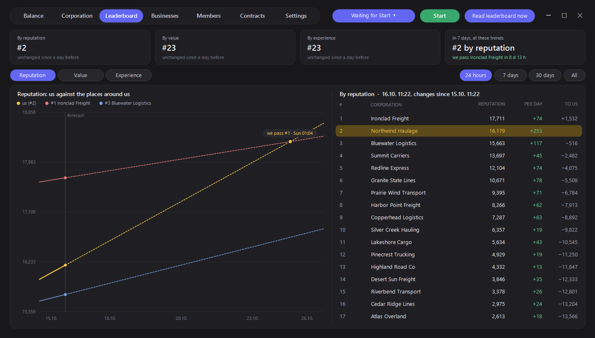
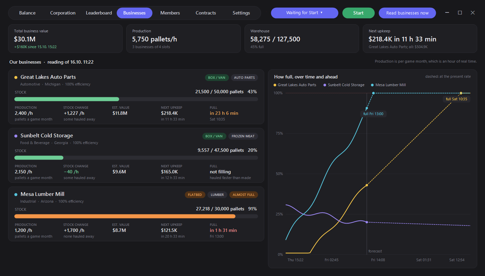
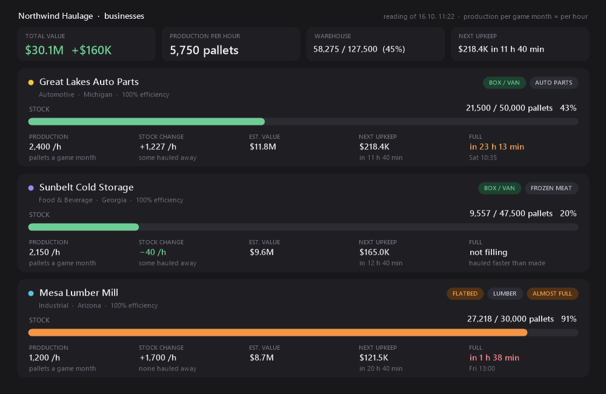
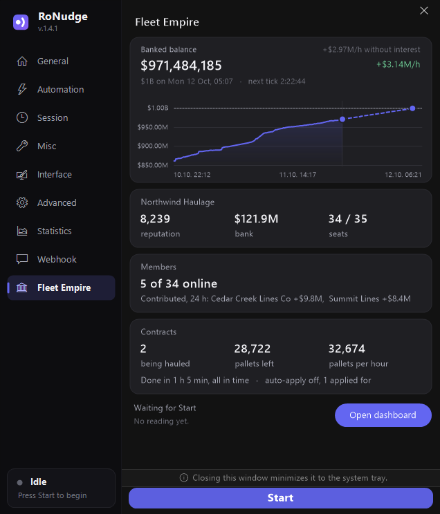

  

<h1 align="center">RoNudge</h1>

Keeps Roblox sessions from being kicked for inactivity.

  

RoNudge sends a small input to each Roblox window on an interval so the 20-minute idle kick never triggers,
and adds the tools you want around that. One exe, no installer, nothing else to install.

## Download

Get `RoNudge.exe` from the [Releases](../../releases) page. This is the only official download. Each
release lists the SHA-256 of the exe so you can check a copy before running it.

## Features

- **Anti-AFK** with a configurable interval and action (jump, W/S, zoom), plus fine-grained timing control
- **Multi-instance** support, with an instance manager and per-instance settings
- **Window tools**: hide/show, opacity, grid layout across monitors
- **Resource savers**: FPS/CPU limiter, RAM cleaner, mute
- **Automation**: auto-start when Roblox opens, auto-reconnect, macros, global hotkey
- **Status overlay** and **Discord webhook** notifications
- **Interface options**: solid or blurred background with adjustable transparency, animations, always on top
- **Fleet Empire tracker**: reads your banked balance, your corporation, its members, contracts, the
  corporation leaderboards and your own businesses from the game window, keeps a history, and shows it all in
  a dashboard with forecasts. Each part can post to Discord on its own webhook and timer

### Fleet Empire tracker

RoNudge only looks at the game: it focuses the window, clicks through the pages, takes screenshots and reads
them with the Windows text recognition. Nothing is injected into Roblox. Every reading runs on a timer you
choose (down to once a minute), and Esc gives a reading up at any time.

- **Balance**: the banked balance over time, income per hour and a forecast to your target
- **Corporation and members**: reputation, bank, seats, and each member's deliveries, contributions and
  last time online
- **Contracts**: the open board with pay per unit, per mile and per trip for your trucks, filters by type and
  cargo; auto-apply with rules per contract type; what the corporation hauls as cards with progress, pace and
  whether it finishes in time, and a sortable history; the contracts you posted and who hauls them
- **Leaderboard**: your place by reputation, value and experience, against the corporations around you, with
  the trend carried forward to when you pass them
- **Businesses**: stock, production per hour, value, upkeep and when each business is full
- **Discord**: pictures and embeds for the balance, corporation, contracts, leaderboard and businesses, news
  as they happen and a daily summary, each on its own webhook

  

  

  

  

  

  

  

  

All screenshots show made-up example data.

## Using it

1. Start RoNudge and open Roblox.
2. Pick an interval and action on the **General** page.
3. Press **Start**. The sidebar shows the live status; closing the window keeps RoNudge in the tray.

Every setting has a **?** button: hover it for a short description, click it for the details.

### Discord webhook

No Discord application or bot is needed. In Discord open the channel settings, then **Integrations**,
**Webhooks**, **New Webhook**, copy its URL and paste it on the **Webhook** page.

## Problems and ideas

Use the [issue tracker](../../issues) of this repository.

## Licence

RoNudge is free to use but not open source: you may not modify, redistribute or reuse it. See
[LICENSE.txt](LICENSE.txt), which also carries the notice for the MIT-licensed code it contains.
